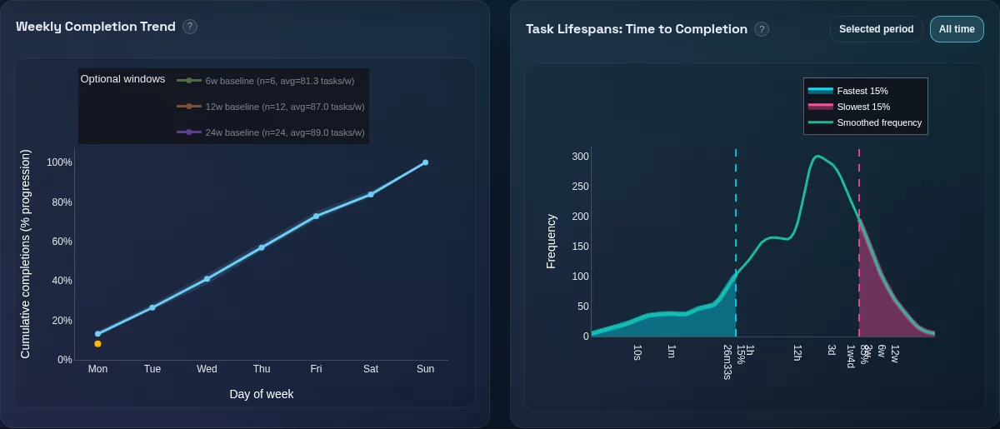
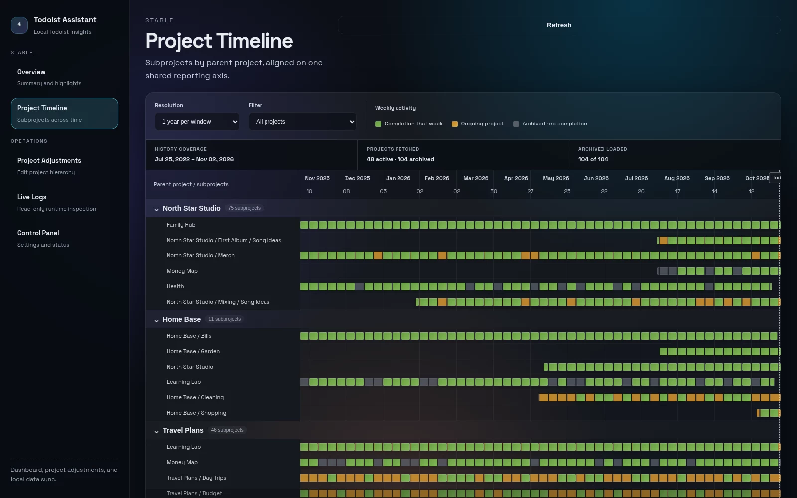
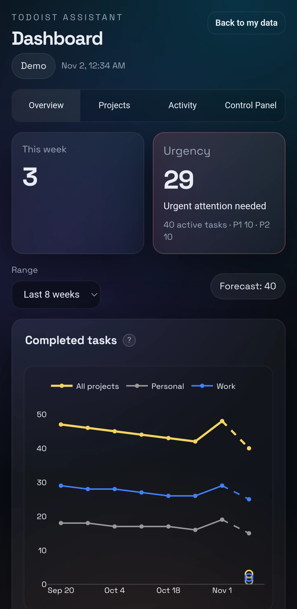

# Todoist Assistant

A local dashboard for Todoist activity, completion history and projects. Available in a browser and as a standalone Android app.



The dashboard includes completion charts and forecasts, a project hierarchy, project timelines, priority counts and configurable attention alerts. Data stays in a local cache and remains available between syncs.

Completions are counted from cached events. Reopening an ordinary task removes its completion from the original period; recurring occurrences stay counted. Forecasts are estimates, with the total calculated from project forecasts.

<details>
<summary>Project timeline</summary>



</details>

## Run locally

Requires Python 3.11–3.13, [uv](https://docs.astral.sh/uv/), Node.js 20.9+ and Make.

```bash
git clone https://github.com/mtyrolski/todoist-summary-plugin.git
cd todoist-summary-plugin
uv sync --locked
npm --prefix frontend ci
make dashboard
```

Open <http://127.0.0.1:3000> and enter your Todoist API token. You can also copy `.env.example` to `.env` and set `API_KEY` there.

```bash
make stop_dashboard  # stop the local servers
make sync            # fetch recent activity
make sync_history    # also fetch older history
make run_demo        # show anonymized local data
```

## Android

The Android app uses the web dashboard's styles, fonts and charts. It syncs directly with Todoist and keeps its own history on the phone. Saved data and the built-in demo work offline; no PC or Python server is needed.



Screenshots use anonymized demo data or the Android sample.

Download the Preview APK from [Android APK workflow artifacts](https://github.com/mtyrolski/todoist-summary-plugin/actions/workflows/android.yml), or build it with JDK 17 and Android SDK 36:

```bash
make build_android_preview
adb install -r dist/android/todoist-assistant-preview.apk
```

Android includes completion, lifespan, activity and priority charts, a project hierarchy and timeline, task search, recent activity and alert settings. Charts use the phone's time zone; historical active-task counts are estimates. See [Android build instructions](docs/ANDROID.md) for requirements and device tests.

To reuse desktop project adjustments, export the saved mappings from Project Adjustments, copy the JSON file to the phone, and import it in the Android Control Panel.

## Development

```bash
make test_all
npm --prefix frontend run lint
npm --prefix frontend test
npm --prefix frontend exec -- playwright install chromium
npm --prefix frontend run test:e2e
```

[Windows and macOS builds](docs/BUILDING.md)
