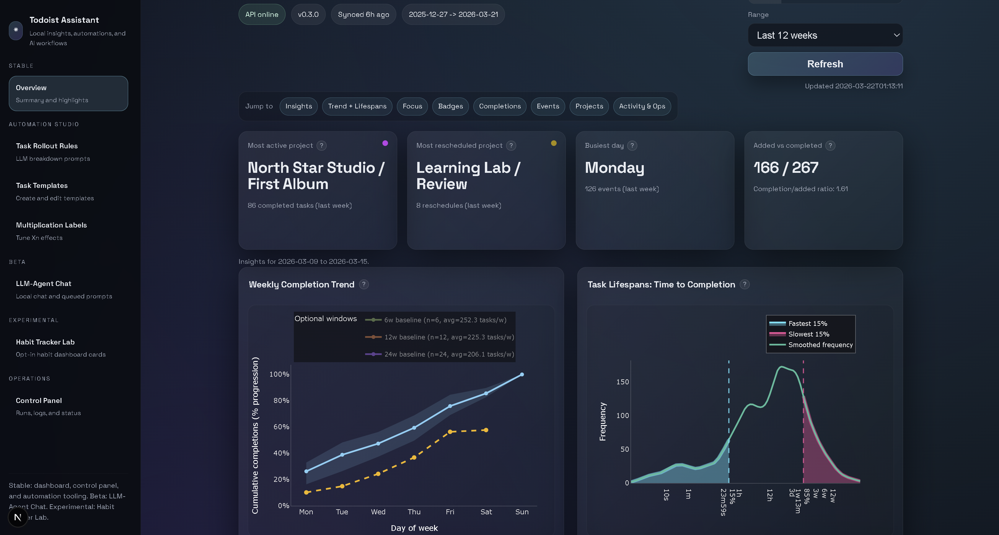

# Todoist Assistant

Todoist Assistant is a local dashboard for Todoist activity and project history. It stores fetched activity on disk and uses that cache to build charts, priorities, project hierarchy views, and the project timeline.



## Quick start

Requirements: Python 3.11, [uv](https://docs.astral.sh/uv/), Node.js 20.9+, and a Todoist API token.

```bash
git clone https://github.com/mtyrolski/todoist-assistant.git
cd todoist-assistant
cp .env.example .env
# Set API_KEY in .env
make setup
make dashboard
```

Open <http://127.0.0.1:3000>. The dashboard refreshes cached activity when needed. You can also fetch activity explicitly:

```bash
make sync          # incremental activity sync
make sync_history  # incremental sync plus older history backfill
make stop_dashboard
```

Activity updates use a one-day overlap, fetch all pages in the range, and merge under a file lock. History windows are checkpointed on disk. Project adjustments are a full-width page under Operations; they preserve archived project mappings locally.

## Development

```bash
uv sync --locked
make test
npm --prefix frontend ci
npm --prefix frontend run lint
npm --prefix frontend test
npm --prefix frontend run build
npm --prefix frontend exec -- playwright install chromium
npm --prefix frontend run test:e2e
```

The Python data and sync code is separate from the web API and frontend. Plots remain in the dashboard modules. The Android app is a standalone native client with its own local event cache. Build an installable APK with `make build_android`, or download the artifact from the Android APK workflow. See [Android build and usage](docs/ANDROID.md).

Completion charts use cached events. Undoing an ordinary completion removes it from its original period; recurring occurrences remain counted. Raw actions stay in activity history. Forecasts combine up to eight prior periods, including empty periods, with the current pace; totals sum project forecasts.

The dashboard refreshes saved data in the background every minute. Failed syncs keep the last view and show a warning.

## Packaging

Windows and macOS packaging remains available through manually triggered workflows; see [Windows installer notes](docs/windows_installer.md).
